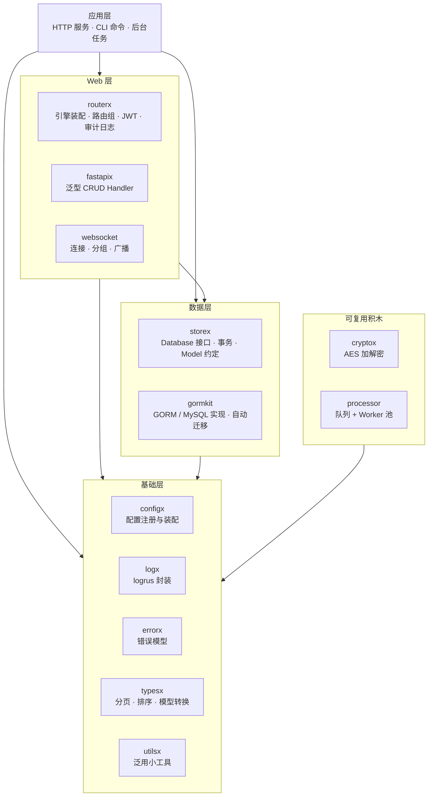
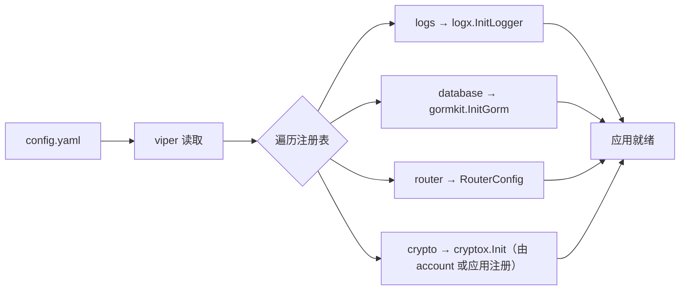
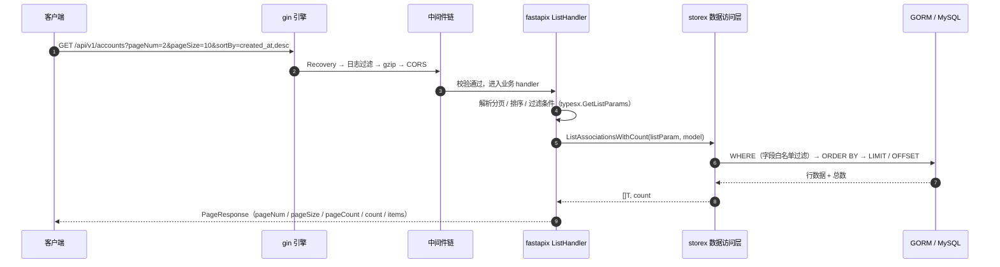

# gotools

一个个人自用的 Go 工具库（module `github.com/zq-xu/gotools`）。

它把"每个新项目都要写一遍、但每个项目都写得不太一样"的那部分固化下来：日志、配置装配、错误模型、分页类型、GORM 数据访问、gin 服务脚手架、泛型 CRUD、WebSocket 连接管理，顺带附上一套自己的小命令。

> 状态：`v0.x`，个人项目，API 会随实际使用调整。技术栈假设是 **gin + GORM + MySQL + viper + logrus + cobra**；换 ORM 需要自己实现 `storex/database.Database` 接口。

---

## 设计原则

库里的每个包都遵循同样四条约定，读懂这四条，剩下的看代码就行：

1. **一域一包，统一带 `x` 后缀**。`logx`、`configx`、`errorx`、`typesx`、`utilsx`、`storex`、`routerx`、`fastapix` —— 加后缀是为了不和标准库或第三方包撞名（`log`、`config` 这些名字在 import 里太容易冲突）。
2. **装配靠注册，不靠手工调用**。各包在自己的 `init()` 里向 `configx` 注册"配置段 + 初始化函数"，应用只需要一句 `configx.Setup("config.yaml")`，日志、数据库、路由、加密就都按配置文件就绪了。
3. **错误只有一个形状**。所有对外错误都是 `errorx.ErrorInfo`（HTTP 状态码 + 消息 + 原始 error），handler 里只需 `ctx.JSON(ei.StatusCode(), ei.ErrorMessage())`。
4. **依赖只向下，不向上**。基础层不知道存储层的存在，存储层不知道 HTTP 层的存在；`cmd/` 可以依赖库，库永远不依赖 `cmd/`。

## 分层架构



箭头即依赖方向。越往下越稳定，越往下改动越需要谨慎——`utilsx` 里一个函数改名，上面四层都会响。

## 目录结构

```
gotools/
├── cmd/
│   └── gotools/main.go       # package main：唯一可执行入口，只有 5 行
├── internal/cli/             # 命令实现，不对外暴露
│   ├── root.go               #   根命令 + 全局 --loglevel
│   ├── format/               #   gotools format（重排 Go import 分组）
│   └── excel/gantt/          #   gotools excel gantt（Excel 甘特图）
│
├── logx/                     # logrus + 自定义 formatter + 全局 Logger
├── configx/                  # viper 注册式配置装配
├── errorx/                   # 带 HTTP 状态码的错误模型
├── typesx/                   # 分页/排序参数、PageResponse、ModelResponse
├── utilsx/                   # 拷贝、指针、时间、文件、Excel 导出、UUID……
│
├── storex/                   # 数据访问抽象
│   ├── database/             #   Database 接口（唯一需要 mock 的边界）
│   ├── gormkit/              #   GORM 实现、事务、Model、自动迁移、错误映射
│   └── account/              #   内置账号模型 + 登录校验
├── routerx/                  # gin 引擎装配
│   ├── auth/                 #   JWT 认证中间件
│   └── auditlog/             #   审计日志（中间件 + 查询 + 导出 Excel）
├── fastapix/                 # 泛型 CRUD handler（getx/、list、update、delete）
├── websocket/                # Hub 模式的连接管理
│
├── cryptox/                  # AES-128/192/256 CBC + PKCS#7
├── processor/                # 队列 + 固定 Worker 池
│
├── _examples/                # 最小示例（config、cryptokit）
├── _demos/                   # 预留
├── Makefile
└── go.mod
```

`cmd/` 只放可执行入口，命令的实现在 `internal/` 里（外部无法 import，因此可以随便改），其余目录都是对外可见的库代码。

## 包一览

| 包 | 定位 | 主要入口 |
| --- | --- | --- |
| `logx` | 日志 | `logx.Logger`、`SetLoggerLevel`、`MyFormatter` |
| `configx` | 配置装配 | `Register` / `RegisterByFile`、`Setup` |
| `errorx` | 错误模型 | `NewError(status, msg, err)`、`Errorf(...)`、`ErrorInfo` |
| `typesx` | 通用类型 | `ListParams`、`PageResponse`、`GetListParams`、`NewSorter` |
| `utilsx` | 杂项工具 | `Copy`、`UnixTime`、`GenerateUUID`、`NewExcelExport`、`Notify` |
| `storex` | 数据访问门面 | `DB(ctx)`、`GormDB(ctx)`、`Model`、`RegisterTable`、`DoDBTransaction` |
| `storex/gormkit` | GORM 实现 | `InitGorm`、自动迁移、错误映射 `NewErrorInfoFor*Error` |
| `storex/account` | 内置账号 | `Account`、`LoadLoginAccount`（配合 JWT 使用） |
| `routerx` | HTTP 引擎 | `NewRouter`、`StartRouter`、`NewGroup`、`RegisterGroup`、`SetHealthHandler` |
| `routerx/auth` | 认证 | `InitAuthMiddleware(loader)`、`GetUserInfoFromToken` |
| `routerx/auditlog` | 审计 | `Middleware`、`ListAuditLog`、`ExportAuditLog` |
| `fastapix` | 泛型 CRUD | `ListHandler`、`UpdateHandler`、`DeleteHandler`、`ListByRawGormHandler` |
| `fastapix/getx` | 泛型 Get | `GetHandler`、`NewDefaultConfig[T, R]`、`ValidateAuthInRoles` |
| `websocket` | WebSocket | `GlobalManager`、`NewConnFromGin`、`NewClient` |
| `cryptox` | 加解密 | `Init(cfg)`、`SetCrypto`、`Encrypt` / `Decrypt`、`NewAesPasswordCrypto(key)` |
| `processor` | 并发处理 | `NewProcessor(pickerGen)`、`Queue`、`Worker`、`Picker` |

## 快速开始

### 安装 CLI

```bash
go install github.com/zq-xu/gotools/cmd/gotools@latest
```

或者本地构建：

```bash
make build          # 产物在 bin/gotools
make format         # 用 gotools format 整理本仓库的 import
```

### 作为库引入

```bash
go get github.com/zq-xu/gotools@v0.0.15
```

```go
import (
    "github.com/zq-xu/gotools/configx"
    "github.com/zq-xu/gotools/logx"
    "github.com/zq-xu/gotools/storex"
    "github.com/zq-xu/gotools/routerx"
)
```

### 一个最小服务

`config.yaml`：

```yaml
logs:
  logLevel: info            # trace / debug / info / warn / error / fatal / panic

database:
  address: 127.0.0.1
  port: 3306
  username: root
  password: root
  database: gotools_demo
  logLevel: 4               # GORM logger：1 Silent / 2 Error / 3 Warn / 4 Info

router:
  host: 0.0.0.0
  port: 8080
  disableTLS: true          # 生产环境去掉这行，并填 certPath / keyPath
  certPath: server.pem
  keyPath: server.key

crypto:
  aesKey: "MDEyMzQ1Njc4OWFiY2RlZjAxMjM0NTY3ODlhYmNkZWY="   # base64 编码的 32 字节密钥
```

`main.go`：

```go
package main

import (
	"context"

	"github.com/gin-gonic/gin"

	"github.com/zq-xu/gotools/configx"
	"github.com/zq-xu/gotools/fastapix"
	"github.com/zq-xu/gotools/fastapix/getx"
	"github.com/zq-xu/gotools/routerx"
	"github.com/zq-xu/gotools/storex/account" // 导入即注册 accounts 表，启动时 AutoMigrate
)

func main() {
	// 一行装配：日志 + 数据库 + 路由配置 + 加密
	if err := configx.Setup("config.yaml"); err != nil {
		panic(err)
	}

	// 配置文件里没写 host/port 时补默认值（0.0.0.0:8080）
	routerx.RouterConfig.OptDefalt()

	routerx.RegisterGroup(
		routerx.NewGroup("/api/v1").AddAPI(
			&routerx.API{Method: "GET", Path: "/accounts", Handler: listAccounts},
			&routerx.API{Method: "GET", Path: "/accounts/:id", Handler: getAccount},
		),
	)

	ctx, cancel := context.WithCancel(context.Background())
	defer cancel()

	// 阻塞运行；ctx 取消后 3 秒内优雅关闭。
	// 想让 Ctrl+C / SIGTERM 生效，还需要自己把信号接到 cancel 上，例如 utilsx.Notify(cancel)。
	if err := routerx.StartRouter(ctx, routerx.NewRouter()); err != nil {
		panic(err)
	}
}

func listAccounts(ctx *gin.Context) {
	fastapix.ListHandler[account.Account](
		ctx,
		fastapix.DefaultListObjWithCount[account.Account],
		fastapix.DefaultTransListObjToResp[account.Account, account.Account],
	)
}

func getAccount(ctx *gin.Context) {
	getx.GetHandler[account.Account, account.Account](
		ctx, getx.NewDefaultConfig[account.Account, account.Account](),
	)
}
```

这两行 handler 就把"分页解析 → 参数过滤 → 排序 → 查询 → 计数 → 转响应"全串起来了。`UpdateHandler` / `DeleteHandler` 同理，只是多给一个改动/校验回调：

```go
func updateAccount(ctx *gin.Context) {
	fastapix.UpdateHandler[account.Account, UpdateAccountParams](
		ctx,
		func(db database.Database, obj *account.Account, p *UpdateAccountParams) errorx.ErrorInfo {
			obj.Name = p.Name
			return nil
		},
	)
}

func deleteAccount(ctx *gin.Context) {
	fastapix.DeleteHandler[account.Account](
		ctx,
		func(db database.Database, obj *account.Account) errorx.ErrorInfo {
			return nil // 返回非 nil 即中断删除
		},
	)
}
```

> 注意：`configx.Setup` 会按注册顺序初始化**已导入**的包。只要 import 了 `storex`，配置里就必须有 `database` 段，否则启动即失败。同理，`routerx` 需要 `router` 段。这是"注册式装配"的代价：依赖是隐式的，靠 import 决定。

### 配置装配机制



给自己的模块加配置段，只需要三行：

```go
var SampleConfig Sample

type Sample struct {
	Port int
	Host string
}

func init() {
	configx.Register("sample", &SampleConfig, func() error { return nil })
}
```

配置文件里出现 `sample:` 段就会被自动填充；`RegisterByFile` 则是"配置里只写文件路径、内容单独放一个文件"的变体（适合证书、大块 JSON 之类）。完整示例见 `_examples/config`。

## 关键约定

### 分页与查询

`typesx.GetListParams(ctx)` 从 query string 解析出一套标准参数：

| 参数 | 含义 |
| --- | --- |
| `pageNum` / `pageSize` | 页码（默认 1）/ 每页条数（默认 10） |
| `sortBy` | `字段,方向`，多字段用 `:::` 分隔，例：`name,asc:::created_at,desc` |
| `fuzzySearch` | 模糊搜索值，配合 `ListParams.FuzzySearchColumnList` 生效 |
| 其它任意 key | 按"模型字段的 snake_case 名"精确过滤，匹配不到的字段静默忽略 |

响应统一是：

```json
{ "pageNum": 2, "pageSize": 10, "pageCount": 3, "count": 25, "items": [ ... ] }
```

**排序键只接受普通标识符**（`^[A-Za-z_][A-Za-z0-9_]*$`），`sortBy` 里夹带 SQL 片段会被直接丢弃；过滤后一个都不剩时回退到默认的 `updated_at,desc`，因此 `ORDER BY` 永远不会是空串。这一层只防注入，不保证字段真实存在于模型上——需要确认字段归属时再调 `listParam.Validate(new(Account))`（`id` / `created_at` / `updated_at` 总是合法）。`fastapix` 的现成 handler 只做前者，后者要自己调。

### Model 约定

所有可持久化模型都嵌 `storex.Model`：

```go
type Model struct {
	ID        int64 `gorm:"primarykey"`    // sonyflake 生成，不是自增
	CreatedAt time.Time
	UpdatedAt time.Time
	DeletedAt gorm.DeletedAt `gorm:"index"` // 软删除
	Comment   string         `gorm:"size:512"`
	Status    int
}
```

三件配套的事：

- `storex.GenerateModel()` 生成一个带雪花 ID 的新模型，别自己拼 ID。
- `storex.RegisterTable(&X{})` 放在 `init()` 里，`InitGorm()` 时会统一自动迁移。
- 表名用 `TableName()` 显式指定，不依赖 GORM 的复数推断。

### 错误与状态码

```go
errorx.NewError(http.StatusBadRequest, "invalid parameters", err) // 自定义状态码
storex.NewErrorInfoForGetError(err)                                // GORM 错误 → HTTP 错误
```

`gormkit` 里有一组 `NewErrorInfoForXxxError`，把常见错误映射成状态码：`ErrRecordNotFound` → 404，唯一键冲突 → 400，其余 → 500。`errorx.ErrorInfo` 同时满足 `error` 接口，所以既能往上传递，也能直接吐给前端。

### 依赖方向

一句话规则：**`cmd/` 与 `_examples/` 可以依赖任何库包；库包之间只能向下依赖，不能反向。** 新增包时先问一句"它属于哪一层"，再决定放哪儿。

## 一次分页请求的路径



## CLI

```bash
gotools --help
gotools --loglevel debug          # 全局日志级别

gotools format --dir .            # 递归重排 import 分组（标准库 / 第三方 / 本模块）
gotools format --file main.go

gotools excel gantt plan.xlsx     # 读 Sheet1 的任务表，在 Sheet2 生成甘特图
```

`format` 的判定规则来自 `go.mod` 里的 module path：import 里包含该前缀的归到"本模块"组，含 `.` 的归第三方组，其余归标准库组，三组之间留空行，最后再过一遍 `go/format`。它只处理 `import (` 块，不碰其它代码。

`excel gantt` 期望 Sheet1 的第一行列名是 `Routes / GroupNo. / StartDate / EndDate`，日期用 `2026/1/1` 这种格式。

## 开发

```bash
make build            # go build -o bin/gotools ./cmd/gotools
make format           # bin/gotools format（需要先 build）
go vet ./...
go test ./...         # 少量单测：cryptox、processor、分页排序、错误映射、excel 导出
```

依赖版本以 `go.mod` 为准；`go.mod` 里声明的是 `go 1.27.4`。

## 结构演进

早期 `gotools.go` 是根目录的 `package main`，导致模块根不可被 import、库与程序挤在同一层。现已调整为常规布局：

- 入口下沉到 `cmd/gotools/main.go`，安装方式随之变成 `go install github.com/zq-xu/gotools/cmd/gotools@latest`；
- `cmd/format`、`cmd/excel` 的实现收进 `internal/cli/`，外部无法 import，可以自由重构；
- `bricks/cryptox`、`bricks/processor` 拉平为顶层的 `cryptox`、`processor`（`bricks` 这一层没有实际分层意义）。

**对外包的 import 路径（`logx`、`configx`、`storex`、`routerx`、`fastapix` 等）一个都没有变**，消费者无需改动；唯一需要跟着改的是 `bricks/*` 的使用方——把 import 里的 `bricks/` 去掉即可。

### 行为变更（同批修复）

- **记录不存在改为 404**：`NewErrorInfoForGetError` 之前把 `gorm.ErrRecordNotFound` 映射成 `400 not found`，现在是 404。前端如果按 400 做过特判，需要同步。
- **`sortBy` 默认过滤非法键**：非标识符的排序键被丢弃，全部非法时回退 `updated_at,desc`；原始字符串不再进入 `ORDER BY`。
- **`cryptox` 不再自己读配置**：去掉了对 `configx` 的依赖，改由 `cryptox.Init(cfg)` / `SetCrypto` 装配。`storex/account` 在 `init()` 里注册了 `crypto` 配置段，所以引用 account 的应用行为不变；只单独用 `cryptox` 的需要自己加一行注册（见 `_examples/cryptokit`）。`aesKey` 为空时跳过初始化、不会让启动失败，真正加密时会返回 `not initialized` 错误。
- **`fastapix.DeleteHandler` 的 `validateFn` 允许为 nil**：之前传 nil 会在删除时 panic。

## 现状与后续

一些已经明确、但还没动手的整理项：

- **`fastapix` 这个名字**：它是基于 gin 的 REST 辅助包，和 Python 的 FastAPI 没有关系，长期看会误导人。改名窗口就在还没有外部消费者的时候。

后续如果要做长期运行的应用（例如基于 Kafka 消费任务的服务），建议**独立仓库**而不是塞进本库：库的 tag 发布节奏不该被应用的部署需求绑架，`go.mod` 也不该被拉进消息队列客户端这类重依赖。本地同时改库和应用时用 `go.work` 把两者串起来即可，不需要 `replace`。
