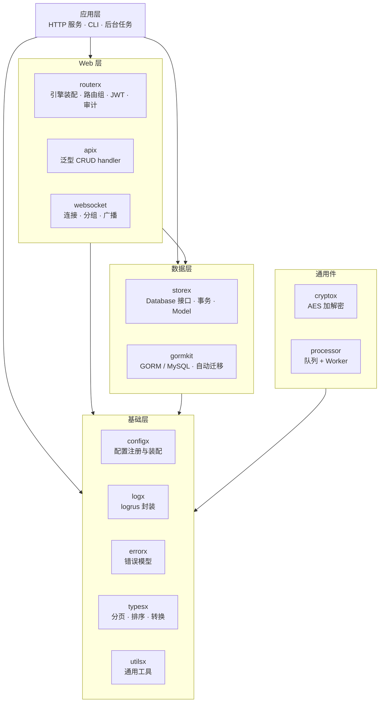

# gotools

基于 gin + GORM 的 Go 服务端基础库：把一个 HTTP 服务里那些「每个项目都要重写一遍、又每次写得不一样」的部分固化成可复用的包，并附一套自用 CLI。

```
module  github.com/zq-xu/gotools
stack   gin · GORM · MySQL · viper · logrus · cobra
```

> 状态 `v0.x`：个人维护，未承诺稳定 API。库本身不带业务语义，只负责装配与约定；具体怎么写业务，见 [`docs/`](docs/README.md)。

## 能力

| 关注点 | 包 | 提供什么 |
| --- | --- | --- |
| 装配与基础设施 | `configx` `logx` `errorx` | 一句话装配配置段；统一日志；单一错误形状 |
| 数据访问 | `storex` `typesx` | `Database` 接口 + GORM 实现、事务、Model 约定、分页排序过滤 |
| HTTP 层 | `routerx` `apix` `websocket` | 引擎装配、路由组 DSL、JWT、审计、泛型 CRUD、连接管理 |
| 通用件 | `cryptox` `processor` `utilsx` | AES 加解密、队列 + Worker 池、杂项工具 |

## 架构



箭头即依赖方向。越靠下越稳定，改动成本也越高：`utilsx` 里改一个函数签名，上面四层都会跟着响。

四条设计约定贯穿全部包，读懂它们其余看代码即可：

1. **一域一包，统一 `x` 后缀** —— `logx`、`configx`、`routerx` 等避免与标准库或第三方包在 import 处撞名。
2. **装配靠注册，不靠手工调用** —— 各包在 `init()` 里向 `configx` 注册「配置段 + 初始化函数」，应用只需 `configx.Setup("config.yaml")`，日志、数据库、路由、加密按注册表依次就绪；代价是依赖隐式：**import 了什么，配置里就必须有什么段**。
3. **错误只有一个形状** —— 对外错误一律 `errorx.ErrorInfo`（状态码 + 消息 + 原始 error），handler 里只有一句 `ctx.JSON(ei.StatusCode(), errorx.NewResponseBody(ei))`，响应体固定为 `{"error": "<message>"}`。
4. **依赖只向下** —— 基础层不知道存储层，存储层不知道 HTTP 层；`cmd/`、`_examples/`、`docs/` 可以依赖库，库永不反向依赖它们。

目录约定：`cmd/` 只放入口，命令实现在 `internal/`（外部不可 import）；以 `_` 开头的目录会被 Go 工具链忽略，用于存放不参与 `./...` 构建的示例与预留位；`docs/` 只放 Markdown，代码一律留在 `_examples/` 里。

## 包索引

| 包 | 定位 | 主要入口 |
| --- | --- | --- |
| `logx` | 日志 | `Logger`、`SetLoggerLevel`、`MyFormatter` |
| `configx` | 配置装配 | `Register` / `RegisterByFile`、`Setup` |
| `errorx` | 错误模型 | `NewError`、`Errorf`、`ErrorInfo` |
| `typesx` | 通用类型 | `ListParams`、`GetListParams`、`PageResponse`、`NewSorter`、`ModelResponse` |
| `utilsx` | 杂项工具 | `Copy`、`UnixTime`、`GenerateUUID`、`NewExcelExport`、`Notify`、`Opt*Ptr` |
| `storex` | 数据访问门面 | `DB(ctx)`、`GormDB(ctx)`、`Model`、`RegisterTable`、`GenerateModel`、`NewErrorInfoFor*Error` |
| `storex/database` | 存储接口 | `Database` |
| `storex/gormkit` | GORM 实现 | `InitGorm`、`DoGormDBTransaction`、`GenerateDBForQuery`、`OptPageDB` |
| `storex/account` | 内置账号 | `Account`、`LoadLoginAccount` |
| `routerx` | HTTP 引擎 | `NewRouter`、`StartRouter`、`NewGroup`、`RegisterGroup`、`SetHealthHandler`、`Login` / `Logout` |
| `routerx/auth` | 认证 | `InitAuthMiddleware`、`Middleware`、`GetUserInfoFromToken` |
| `routerx/auditlog` | 审计 | `Middleware`、`ListAuditLog`、`ExportAuditLog`、`ModelAuditLog` |
| `apix` | 泛型 CRUD | `ListHandler`、`ListByRawGormHandler`、`UpdateHandler`、`DeleteHandler`、`WithFilter` |
| `apix/getx` | 泛型 Get | `GetHandler`、`NewDefaultConfig[T, R]`、`ValidateAuthInRoles` |
| `websocket` | WebSocket | `GlobalManager`、`NewConnFromGin`、`NewClient` |
| `cryptox` | 加解密 | `Init`、`SetCrypto`、`Encrypt` / `Decrypt`、`NewAesPasswordCrypto` |
| `processor` | 并发处理 | `NewProcessor`、`Queue`、`Worker`、`Picker` |

## 安装

```bash
# 作为库
go get github.com/zq-xu/gotools@latest

# 作为 CLI
go install github.com/zq-xu/gotools/cmd/gotools@latest
```

## 快速开始

```bash
mkdir demo && cd demo
go mod init demo
go get github.com/zq-xu/gotools@latest
```

三件事做完即可跑起来，完整步骤与代码见 [docs/01-quickstart.md](docs/01-quickstart.md)：

1. 准备一个 `config.yaml`（`logs`、`database`、`router` 三个段，用到账号时再加 `crypto`）；
2. `configx.Setup("config.yaml")` 完成装配；
3. `routerx.RegisterGroup(...)` 挂路由，`routerx.StartRouter(ctx, routerx.NewRouter())` 阻塞运行。

## 示例

四个可直接运行的小服务，每个都对应一篇文档；代码在 `_examples/` 下，文档只讲结构与关键片段。

| 示例 | 场景 | 运行 |
| --- | --- | --- |
| [`_examples/quickstart`](_examples/quickstart) | 最小 HTTP 服务 + 分页列表 | `go run .` |
| [`_examples/rest-api-service`](_examples/rest-api-service) | JWT 登录、账号 CRUD、审计导出 | `go run . -seed` 后 `go run .` |
| [`_examples/worker-service`](_examples/worker-service) | 队列 + 5 个固定 Worker | `go run .` |
| [`_examples/cli-service`](_examples/cli-service) | cobra 子命令、全局 flag | `go run . greet Alan -n 3` |

前两个需要 MySQL（库名 `gotools_demo`），后两个不依赖外部服务。示例被 `_` 前缀排除在 `./...` 之外，单独检查用 `make examples`。

## 文档

按场景组织在 [`docs/`](docs/README.md)，从 [docs/01-quickstart.md](docs/01-quickstart.md) 入手，完整索引与阅读路径见 [docs/README.md](docs/README.md)。

## CLI

```bash
gotools --help
gotools --loglevel debug          # 全局日志级别

gotools format                    # 按 go.mod module path 重排 import 三组
gotools format --dir .            # 或指定目录
gotools format --file main.go

gotools excel gantt plan.xlsx     # 读 Sheet1 的任务表，在 Sheet2 生成甘特图
```

`format` 只处理 `import (` 块：本模块前缀归一组、含 `.` 的归第三方组、其余归标准库组，组间留空行，最后过一遍 `go/format`。`excel gantt` 期望 Sheet1 首行列名为 `Routes / GroupNo. / StartDate / EndDate`，日期形如 `2026/1/1`。

## 开发

```bash
make build            # go build -o bin/gotools ./cmd/gotools
make format           # bin/gotools format（需先 build）
make test             # go test ./...
make examples         # 逐个 go vet _examples 下的包（示例不在 ./... 里，且 ./_examples/... 匹配不到）
go vet ./...
```

文档里的代码与 `_examples/` 保持同步：改示例即改文档，文档只引用路径与关键片段。

依赖版本以 `go.mod` 为准。

## 已知限制

- **JWT 密钥默认值**：不传 `routerx.WithKey` 时沿用开发用默认密钥（启动打 warn 日志），生产环境必须显式指定；`TokenLookup` / `TokenHeadName` 固定。
- **sonyflake machine ID 需按实例区分**：默认按 `GOTOLS_MACHINE_ID` 环境变量 → 私网 IPv4 低 16 位 → hostname 哈希推导，多机写同一张表时请为每台机器设置互不相同的 `GOTOLS_MACHINE_ID`。
- **`websocket` 只做 Origin 校验**：默认仅放行同源，token 鉴权仍需通过 `websocket.SetCheckOrigin(fn)` 或握手前的 handler 自行实现；无心跳、单进程等语义见 [docs/10](docs/10-websocket.md)。
- **`apix` 不提供 Create handler**，审计记录的 `UserID / UserName` 恒为空（见 [docs/02](docs/02-rest-api-service.md)）。
