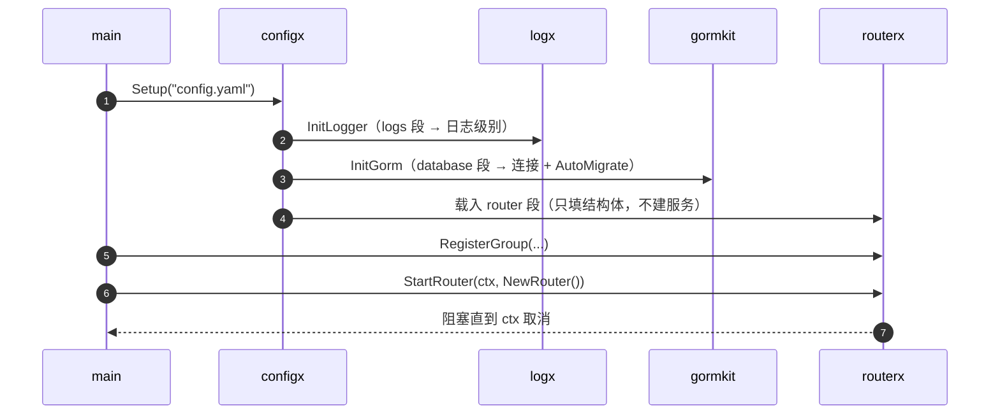

# 01 快速开始

目标：一份配置 + 一个 `main.go`，跑起能查询列表的 HTTP 服务。全程不需要写装配代码。

## 前置

- Go 1.27.x（以 `go.mod` 声明为准）
- 一个可连的 MySQL：

```sql
CREATE DATABASE gotools_demo DEFAULT CHARACTER SET utf8mb4;
```

## 1. 新建模块

```bash
mkdir demo && cd demo
go mod init demo
go get github.com/zq-xu/gotools@latest
```

## 2. 写配置

`config.yaml`：

```yaml
logs:
  logLevel: info            # trace / debug / info / warn / error / fatal / panic

database:
  address: 127.0.0.1
  port: 3306
  username: root
  password: root
  database: gotools_demo
  logLevel: 4               # GORM logger：1 Silent / 2 Error / 3 Warn / 4 Info

router:
  host: 0.0.0.0
  port: 8080
  disableTLS: true          # 生产环境去掉这行并填 certPath / keyPath
  certPath: server.pem
  keyPath: server.key

crypto:
  aesKey: "YWJjZGVmZ2hpamtsbW5vcHFyc3R1dnd4"   # base64 的 24 字节密钥，见 09 章
```

> `crypto` 段只在 import 了 `storex/account` 时才需要；`logs` 段由 `configx` 自己注册，因此总是有效。

## 3. 写代码

`main.go`：

```go
package main

import (
	"context"

	"github.com/gin-gonic/gin"

	"github.com/zq-xu/gotools/apix"
	"github.com/zq-xu/gotools/configx"
	"github.com/zq-xu/gotools/routerx"
	"github.com/zq-xu/gotools/storex/account" // 导入即注册 accounts 表与 crypto 配置段
	"github.com/zq-xu/gotools/utilsx"
)

func main() {
	if err := configx.Setup("config.yaml"); err != nil {
		panic(err)
	}

	// 配置里没写 host/port 时补 0.0.0.0:8080
	routerx.RouterConfig.OptDefalt()

	routerx.RegisterGroup(
		routerx.NewGroup("/api/v1").AddAPI(
			&routerx.API{Method: "GET", Path: "/accounts", Handler: listAccounts},
		),
	)

	ctx, cancel := context.WithCancel(context.Background())
	defer cancel()
	utilsx.Notify(cancel) // 把 SIGINT / SIGTERM 接到 ctx 上

	if err := routerx.StartRouter(ctx, routerx.NewRouter()); err != nil {
		panic(err)
	}
}

func listAccounts(ctx *gin.Context) {
	apix.ListHandler[account.Account](
		ctx,
		apix.DefaultListObjWithCount[account.Account],
		apix.DefaultTransListObjToResp[account.Account, account.Account],
	)
}
```

## 4. 运行

```bash
go run .
```

启动日志按注册顺序打印，四行都出现即装配完成：

```
Succeed to init logs
Succeed to init database
Succeed to init router
Succeed to init crypto
Starting server at 0.0.0.0:8080
```

## 5. 验证

```bash
curl -s localhost:8080/health
# {}

curl -s 'localhost:8080/api/v1/accounts?pageNum=1&pageSize=10&sortBy=created_at,desc'
# {"pageNum":1,"pageSize":10,"pageCount":0,"count":0,"items":[]}
```

`accounts` 表在启动时由 `AutoMigrate` 建好，此时是空表，所以 `items` 为空、`count` 为 0。

## 这一步发生了什么



关键是**没有显式初始化调用**：`import` 触发了各包的 `init()`，注册表在 `Setup` 时被依次执行。这也是使用本库最容易踩坑的地方——见下一节。

## 常见问题

| 现象 | 原因 |
| --- | --- |
| `failed to setup database` | 配置里缺 `database` 段。import 了 `storex` 就必须提供该段 |
| 启动后表不存在 | 模型没有 `storex.RegisterTable(&X{})`，或定义它的包没有被 import |
| `empty config found for ...` 打印在 stdout | 正常提示，该段为空；需要就去掉对应 import |
| 端口被占用 | `router.port` 改成其它端口，或先停掉占用进程 |
| `cannot find GOROOT directory` | shell 里残留了指向已删除目录的 `GOROOT`，用 `env -u GOROOT go run .` |

下一步：把列表接口扩成完整 CRUD 与登录，见 [02 REST 服务](02-rest-api-service.md)。
