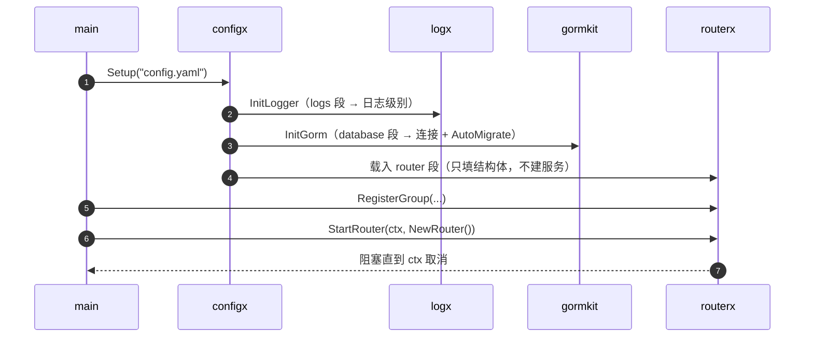

# 01 快速开始

目标：跑通一个能查询列表的 HTTP 服务。全部代码在 [`_examples/quickstart/`](../_examples/quickstart/)，两个文件、60 行左右。

## 前置

- Go 1.27.x（以 `go.mod` 声明为准）
- 一个可连的 MySQL：

```sql
CREATE DATABASE gotools_demo DEFAULT CHARACTER SET utf8mb4;
```

## 方式一：直接跑仓库里的示例

```bash
cd _examples/quickstart
go run .
```

`config.yaml` 里的连接信息（`127.0.0.1:3306`、`root/root`、库名 `gotools_demo`）按自己环境改一下。

## 方式二：复制成自己的项目

```bash
mkdir demo && cd demo
go mod init demo
go get github.com/zq-xu/gotools@latest
cp <仓库>/_examples/quickstart/{main.go,config.yaml} .
go run .
```

## 文件说明

| 文件 | 作用 |
| --- | --- |
| [`main.go`](../_examples/quickstart/main.go) | 装配、路由注册、启动；一个列表 handler |
| [`config.yaml`](../_examples/quickstart/config.yaml) | `logs` / `database` / `router` / `crypto` 四个配置段 |

`main.go` 的骨架只有三段：

```go
configx.Setup("config.yaml")        // 按注册表初始化日志、数据库、路由配置、加密
routerx.RouterConfig.OptDefalt()    // 补 host/port 默认值（不会自动调用）
routerx.StartRouter(ctx, routerx.NewRouter())   // 阻塞运行，ctx 取消后优雅退出
```

列表 handler 是泛型函数，两行拿到「分页解析 → 过滤 → 排序 → 查询计数 → 转响应」的完整链路：

```go
apix.ListHandler[account.Account](
	ctx,
	apix.DefaultListObjWithCount[account.Account],
	apix.DefaultTransListObjToResp[account.Account, account.Account],
)
```

## 验证

启动日志按注册顺序打印，四行都出现即装配完成：

```
Succeed to init logs
Succeed to init database
Succeed to init router
Succeed to init crypto
Starting server at 0.0.0.0:8080
```

```bash
curl -s localhost:8080/health
# {}

curl -s 'localhost:8080/api/v1/accounts?pageNum=1&pageSize=10&sortBy=created_at,desc'
# {"pageNum":1,"pageSize":10,"pageCount":0,"count":0,"items":[]}
```

`accounts` 表在启动时由 `AutoMigrate` 建好，此时是空表。

## 这一步发生了什么



关键是**没有显式初始化调用**：`import` 触发各包 `init()`，注册表在 `Setup` 时依次执行。这也是最容易踩坑的地方——见下一节。

## 常见问题

| 现象 | 原因 |
| --- | --- |
| `failed to setup database` | 配置里缺 `database` 段。import 了 `storex` 就必须提供 |
| 启动后表不存在 | 模型没有 `storex.RegisterTable(&X{})`，或定义它的包没被 import |
| `empty config found for ...` 打印在 stdout | 正常提示，该段为空；不需要就去掉对应 import |
| 端口被占用 | 改 `router.port`，或先停掉占用进程 |
| `cannot find GOROOT directory` | shell 里残留了指向已删除目录的 `GOROOT`，用 `env -u GOROOT go run .` |

下一步：[02 REST 服务](02-rest-api-service.md)。
