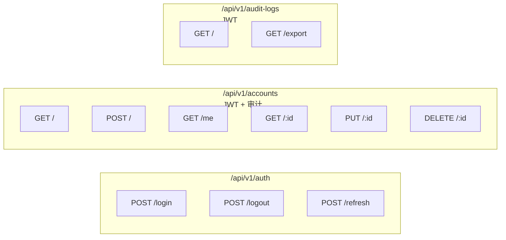

# 02 示例服务 A：账号管理 REST API

一个接近真实后端的骨架：JWT 登录、账号 CRUD、分页查询、写操作审计。

代码在 [`_examples/rest-api-service/`](../_examples/rest-api-service/)：

| 文件 | 作用 |
| --- | --- |
| [`main.go`](../_examples/rest-api-service/main.go) | 装配、路由表、启动；`-seed` 参数初始化管理员 |
| [`handlers.go`](../_examples/rest-api-service/handlers.go) | 五个业务 handler |
| [`config.yaml`](../_examples/rest-api-service/config.yaml) | 四个配置段，`crypto` 必填（账号密码密文存储） |

## 路由表



| 能力 | 由谁提供 |
| --- | --- |
| 启动装配 | `configx` |
| 路由表与中间件 | `routerx` |
| 登录与 token | `routerx` + `routerx/auth` |
| 账号模型与密码校验 | `storex/account` |
| 列表 / 详情 / 更新 / 删除 | `apix`、`apix/getx` |
| 写操作留痕与导出 | `routerx/auditlog` |

## 运行

```bash
cd _examples/rest-api-service

# 第一次：建库并写入管理员 admin/admin123，然后退出
go run . -seed

# 正常启动，监听 8080
go run .
```

`-seed` 只是示例里的一种初始化方式，真实项目更适合做成子命令（见 [04 CLI](04-cli-service.md)）或迁移脚本。

## 装配顺序

`main.go` 里三件事的顺序是有讲究的：

```go
configx.Setup("config.yaml")                  // 1. 日志、数据库、router 段、crypto 就绪
routerx.InitAuthMiddleware(account.LoadLoginAccount)   // 2. 告诉 JWT 怎么校验账号
jwtMW, err := routerx.AuthMiddleware()        // 3. 取实例，注册路由时才拿得到 RefreshHandler
```

漏了 2 会 panic（`empty middleware`）；漏了 3，`/refresh` 与受保护路由都没法挂。

## 路由组与中间件

```go
routerx.NewGroup("/accounts").
	AddMiddlewares(jwtMW.MiddlewareFunc(), auditlog.Middleware.MiddlewareFunc()).
	AddAPI(...)
```

- 组可以嵌套，`/api/v1` + `/accounts` 拼出完整路径；`Path: ""` 表示直接落在组路径上。
- 中间件顺序即执行顺序：`jwtMW` 先把 claims 写进 ctx，`auditlog` 才能识别操作人。
- `RegisterGroup` 是全局注册，必须在 `NewRouter()` 之前完成。
- 路径参数统一 `:id`，handler 里用 `routerx.GetID(ctx)` 取。

## handler 的分工

| handler | 做的事 | 谁实现 |
| --- | --- | --- |
| `createAccount` | 绑定入参、加密密码、查重、落库 | 手写，见 [handlers.go](../_examples/rest-api-service/handlers.go) |
| `listAccounts` | 分页 + 过滤 + 排序 + 计数 | `apix.ListHandler` |
| `getAccount` | 按 id 取详情并转响应 | `apix/getx.GetHandler` |
| `updateAccount` | 事务内取原对象、应用 diff、保存 | `apix.UpdateHandler` |
| `deleteAccount` | 事务内取对象、校验、删除 | `apix.DeleteHandler` |

**`apix` 故意不提供 Create**：创建时的查重规则、初始状态、默认值每个模型都不同，泛化只会把业务规则塞回回调里。示例里的写法是「事务 + 唯一性断言 + 错误映射」：

```go
ei := storex.DB(ctx).DoDBTransaction(func(db database.Database) errorx.ErrorInfo {
	if ei := db.EnsureNotExistByField(obj, "username", p.Username); ei != nil {
		return ei                       // 409 already exists
	}
	if err := db.Create(obj); err != nil {
		return storex.NewErrorInfoForCreateError(err)
	}
	return nil
})
```

注意 `EnsureNotExistByName` 查的是模型的 `name` 字段，不是 `username`——账号查重要用 `EnsureNotExistByField`。

## 请求示例

登录（成功返回 201）：

```bash
curl -s -X POST localhost:8080/api/v1/auth/login \
  -H 'Content-Type: application/json' \
  -d '{"username":"admin","password":"admin123"}'
# {"token":"eyJhbGciOi...","expire":"2026-11-20T18:00:00+01:00"}

TOKEN='eyJhbGciOi...'
```

列表（分页、排序、精确过滤、模糊搜索）：

```bash
curl -s 'localhost:8080/api/v1/accounts?pageNum=2&pageSize=10&sortBy=created_at,desc' \
  -H "Authorization: Bearer $TOKEN"

# 按 username 精确过滤（key 用模型字段的 snake_case）
curl -s 'localhost:8080/api/v1/accounts?username=admin' -H "Authorization: Bearer $TOKEN"
```

详情、当前登录人、更新、删除：

```bash
curl -s localhost:8080/api/v1/accounts/123456789 -H "Authorization: Bearer $TOKEN"
curl -s localhost:8080/api/v1/accounts/me -H "Authorization: Bearer $TOKEN"

curl -s -X PUT localhost:8080/api/v1/accounts/123456789 \
  -H "Authorization: Bearer $TOKEN" -H 'Content-Type: application/json' \
  -d '{"name":"Alan","roles":"admin,operator"}'

curl -s -o /dev/null -w '%{http_code}\n' -X DELETE localhost:8080/api/v1/accounts/123456789 \
  -H "Authorization: Bearer $TOKEN"
```

审计日志（只记录成功的写操作）：

```bash
curl -s 'localhost:8080/api/v1/audit-logs?pageNum=1&pageSize=20' -H "Authorization: Bearer $TOKEN"
curl -s -o auditlog.xlsx 'localhost:8080/api/v1/audit-logs/export' -H "Authorization: Bearer $TOKEN"
```

## 行为约定

| 端点 | 成功 | 失败 |
| --- | --- | --- |
| `POST /auth/login` | 201 `{token, expire}` | 401 账号或密码错误 |
| `GET /accounts` | 200 `PageResponse` | 400 分页参数非法 |
| `POST /accounts` | 201 账号对象 | 400 参数错误 / 409 用户名已存在 |
| `GET /accounts/:id` | 200 账号对象 | 404 不存在 |
| `PUT /accounts/:id` | **201**（沿用库内约定） | 404 不存在 / 400 参数或保存失败 |
| `DELETE /accounts/:id` | 204 无 body | 不存在时同样 204（幂等） |

`PUT` 返回 201 是 `apix.UpdateHandler` 的既有实现，前端按状态码特判时注意。

## 加角色限制

详情类 handler 可以直接挂角色校验：

```go
cfg := getx.NewDefaultConfig[account.Account, account.Account]()
cfg.ValidateFn = getx.ValidateAuthInRoles("admin", "operator")
getx.GetHandler[account.Account, account.Account](ctx, cfg)
```

命中任意角色放行，否则 403；没有 claims 时 401。它只对**已过 JWT 中间件**的路由有效。

`apix.ListHandler` 等没有 ValidateFn 参数，需要自己在 handler 开头判断：

```go
if !slices.Contains(routerx.GetUserInfoFromToken(ctx).Roles, "admin") {
	ctx.JSON(http.StatusForbidden, "permission denied")
	return
}
```

## 已知限制

- `routerx/auth` 的 JWT `Key` 与 `Timeout` 写死，真实环境前需要改库或替换中间件（见 [08](08-auth-and-audit.md)）。
- 审计记录里 `UserID / UserName` 目前恒为空。
- `apix` 不提供 Create handler，也不提供批量操作。

下一步：[03 Worker 服务](03-worker-service.md)。
