# 03 示例服务 B：队列 + Worker 后台任务

一个长驻的批处理进程：生产者在任意 goroutine 投递任务，固定数量的 worker 并发消费，收到信号后优雅退出。

## 适用与不适用

| 场景 | 是否适合 `processor` |
| --- | --- |
| 进程内产生、进程内消费的异步任务（发邮件、生成报表、写审计明细） | 适合 |
| 任务需要跨进程/跨机器分发（Kafka、RabbitMQ 这类消息队列） | **不适合**，见文末 |
| 任务必须持久化、重启后继续 | **不适合**，队列在内存里 |

## 工作模型

```mermaid
flowchart LR
    P["生产者<br/>任意 goroutine"] -->|Push| Q["Queue<br/>chan + 内存切片"]
    Q --> W1["Worker 1"]
    Q --> W2["Worker 2"]
    Q --> W3["... 共 5 个"]
    W1 --> K1["Picker.Pickup"]
    W2 --> K2["Picker.Pickup"]
    W3 --> K3["Picker.Pickup"]
```



- worker 数量固定为 5（`defaultWorkerCount`），不支持配置。
- `NewProcessor` 会调用 5 次 `PickerGenerateFn`，**每个 worker 拿到独立的 `Picker` 实例**；有状态资源（DB 连接、HTTP client）可以在 Picker 里按 worker 持有。
- `Push` 只是入队，不阻塞调用方；队列在内存中，进程退出即丢。

## 代码

```go
package main

import (
	"context"
	"time"

	"github.com/zq-xu/gotools/logx"
	"github.com/zq-xu/gotools/processor"
	"github.com/zq-xu/gotools/utilsx"
)

type Task struct {
	ID   int64
	Name string
}

type taskPicker struct {
	// 真实场景里这里通常持有 DB 连接、HTTP client 之类
}

func (p *taskPicker) Pickup(i interface{}) {
	task, ok := i.(*Task)
	if !ok {
		logx.Logger.Warnf("unexpected job type: %T", i)
		return
	}

	logx.Logger.Infof("handle task %d/%s", task.ID, task.Name)
	time.Sleep(50 * time.Millisecond)
}

func main() {
	p, err := processor.NewProcessor(func() (processor.Picker, error) {
		return &taskPicker{}, nil
	})
	if err != nil {
		panic(err)
	}

	ctx, cancel := context.WithCancel(context.Background())
	defer cancel()
	utilsx.Notify(cancel)

	// 生产者在别的 goroutine 里持续投递任务
	go func() {
		for i := 0; i < 20; i++ {
			p.Push(&Task{ID: int64(i), Name: "demo"})
		}
	}()

	// Start 会阻塞到 ctx 被取消，内部是 5 个固定 worker 消费同一个队列
	p.Start(ctx)

	logx.Logger.Infof("done=%d perWorker=%v", p.DoneLength(), p.WorkerOverview())
}
```

运行与退出：

```bash
go run .            # Ctrl+C 触发 ctx 取消，等待在途任务结束后打印统计
# done=20 perWorker=[5 4 4 4 3]
```

## 三个要点

1. **`Start(ctx)` 是阻塞的**，等价于 `wg.Wait()`；想让主线程做别的事（比如同时起 HTTP 服务），把它放进 goroutine。
2. **`Picker` 里不要 panic**：worker 没有 recover，`Pickup` 里 panic 会带走整个进程。需要兜底就自己 `defer recover()`。
3. **退出是协作式的**：`ctx` 取消后 worker 会在下一次循环退出，正在执行的 `Pickup` 不会被中断。收尾逻辑（关闭连接、flush）放在 `Start` 返回之后。

## 观测

```go
p.DoneLength()      // 累计完成数（原子性一般，够用）
p.WorkerOverview()  // 每个 worker 的完成数，长度固定 5
```

`Done()` 返回的 channel **目前没有写入方**，不要拿它做完成信号；需要的话用 `DoneLength()` 轮询。

## 与 HTTP 服务共存

同一进程里既提供 API 又跑后台任务时，把两者放在同一个 `ctx` 下：

```go
go func() {
	_ = routerx.StartRouter(ctx, routerx.NewRouter())
}()

p.Start(ctx)   // 或再开一个 goroutine，用 WaitGroup 收口
```

两者共享 `configx.Setup` 的成果（同一个 `storex.DB`），不需要重复装配。

## 换成 Kafka 时怎么做

不要试图把 Kafka 塞进 `processor`：它的 `Queue` 是进程内实现，`NewProcessor` 也不接受外部注入队列。正确做法是新建一个独立仓库（例如 `zq-xu/task-worker`），在自己的 `main` 里写消费循环：

```go
cfg := kafka.NewReader(...)
for {
	msg, err := cfg.ReadMessage(ctx)   // 自己处理 offset / 重试 / 幂等
	if err != nil {
		break
	}
	handle(msg)                        // 内部继续用 logx / storex 写库
}
```

这样做的理由：库的 tag 发布节奏不该被应用的部署节奏绑架，`go.mod` 也不该被拉进 Kafka 客户端这种重依赖；而 `logx` / `configx` / `storex` 这三个包在独立仓库里照样能 import。本地同时改库和应用时用 `go.work` 串起来即可，不需要 `replace`。

参考：[05 配置与日志](05-config-and-logging.md) 了解如何在后台进程里同样用 `configx` 装配。
