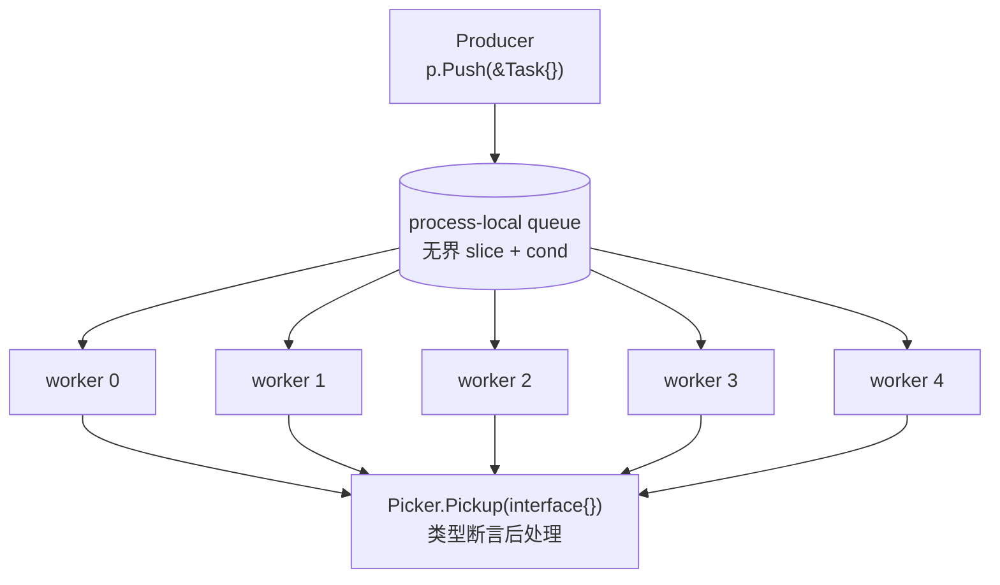
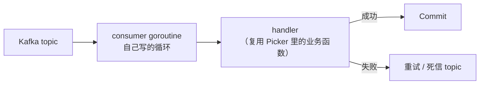

# 03 示例服务 B：后台 Worker 服务

一种「常驻进程 + 内存队列 + 固定 worker」的任务处理骨架，适合做定时拉取、批处理、离线计算这类没有 HTTP 入口的服务。

代码在 [`_examples/worker-service/main.go`](../_examples/worker-service/main.go)（单文件，不需要配置）。

## 运行

```bash
cd _examples/worker-service
go run .          # Ctrl-C 后打印统计并退出
```

输出形如：

```
INFO ... handle task 3/demo
INFO ... handle task 17/demo
INFO ... done=20 perWorker=[4 3 5 4 4]
```

`perWorker` 是**按 worker 下标排列的切片**，不是 map。

## 模型



要点：

- worker 数量**固定为 5**（`defaultWorkerCount`），不可配置；`NewProcessor` 也不接受外部注入的队列。
- 队列是**无界**的进程内队列（`[]interface{} + sync.Cond`），`Push` 永不阻塞；分发到 worker 的那一端是无缓冲 channel。
- `Push` 的入参是 `interface{}`，`Pickup` 里用类型断言还原，断言失败请自行记日志并返回（不要 panic，否则会打死一个 worker）。
- `Start(ctx)` 阻塞到 ctx 取消；`Stop()` 与之等价，二者选一个。
- 队列是进程内内存队列：进程退出，未消费的任务就丢了。需要「重启不丢、多实例共享」就得换消息队列，见下文。

`Picker` 接口只有两个方法：

```go
type Picker interface {
	Pickup(interface{})
}
```

`NewProcessor(func() (processor.Picker, error) { ... })` 的工厂函数在**每个 worker 启动时各调用一次**，因此可以在里面给每个 worker 建独立资源（DB 连接、HTTP client），互不共享。

## 观测

| 方法 | 含义 |
| --- | --- |
| `DoneLength()` | 已完成任务计数，`int64`，只增不减 |
| `WorkerOverview()` | 每个 worker 的已完成数量，`[]int64`，长度 5 |

`p.Done()` 返回 `chan bool`（缓冲 1），在 `Stop()` / ctx 取消、**所有 worker 退出之后**收到一次信号，可以直接当完成通知用：`<-p.Done()`。

示例里用 `utilsx.Notify(cancel)` 把 SIGINT/SIGTERM 转成 ctx 取消：

```go
ctx, cancel := context.WithCancel(context.Background())
defer cancel()
utilsx.Notify(cancel)
```

## 换成 Kafka 的正确姿势

`processor` 的队列是封闭的，不要试图把 Kafka consumer 塞进去。推荐分层：



也就是说：

1. Kafka consumer 循环自己起，`ReadMessage` 之后调用业务函数（可复用 `taskPicker` 里的逻辑）。
2. 成功才 commit offset；失败按退避重投或进死信。
3. 需要并发时，`processor` 可以作为「本地并发限流器」：consumer 读到消息 → `p.Push(&Job{...})`，Picker 里处理完再 commit（此时 commit 需要把 offset 一起塞进 `Job`）。

这个组合没有现成封装，属于使用方自己拼的部分；`processor` 只保证「5 个 worker 抢一个队列」这件事。

下一步：[04 CLI 服务](04-cli-service.md)。
