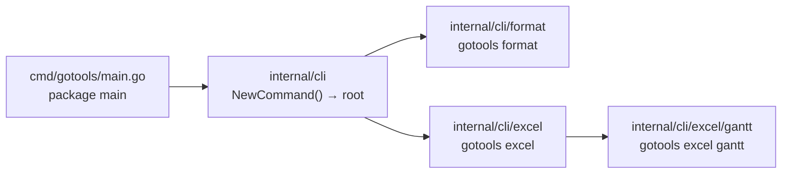

# 04 示例服务 C：命令行工具

仓库自己就是一个 CLI 项目（`gotools` 里带 `format`、`excel gantt` 两个子命令），这一篇讲两件事：本库 CLI 的组织方式，以及用 cobra 给自己的项目做一个同构的命令行工具。

## 本库的 CLI 结构



约定：

| 位置 | 职责 |
| --- | --- |
| `cmd/gotools/main.go` | 唯一入口，只做 `cobra.CheckErr(cli.NewCommand().Execute())` |
| `internal/cli/root.go` | 组装 root 命令、全局 flag、`AddCommand` |
| `internal/cli/<feature>/` | 每个子命令一个包，导出 `NewXxxCommand()` |
| `internal/` | 不对外暴露；需要被外部复用的能力才提到顶层包 |

`internal/` 而不是 `pkg/`：Go 的 `internal` 保证「同一个 module 外的代码无法 import」，这是真正想要的边界；`pkg/` 只是个不起眼的目录名，不提供任何约束。

内置命令：

| 命令 | 作用 |
| --- | --- |
| `gotools format` | 格式化目录或单个 go 文件，`--file` 与 `--dir` 不能同时给 |
| `gotools excel gantt` | 生成甘特图 Excel |
| `gotools --help` | 根命令只打印问候语，真正的功能都在子命令里 |

构建：

```bash
make build          # 输出 bin/gotools
./bin/gotools --help
./bin/gotools format --dir .
```

## 给自己的项目写 CLI

完整代码在 [`_examples/cli-service/main.go`](../_examples/cli-service/main.go)。

```bash
cd _examples/cli-service
go run . greet
go run . greet Alan -n 3
go run . --loglevel debug greet
```

它在结构上刻意和本库保持一致：

```go
root := &cobra.Command{
	Use:   "demo",
	PersistentPreRunE: func(cmd *cobra.Command, args []string) error {
		return logx.SetLoggerLevel(logLevel)      // 全局 flag → 日志级别
	},
}
root.PersistentFlags().StringVarP(&cfgFile, "config", "c", "config.yaml", "config file")
root.AddCommand(newGreetCommand())
cobra.CheckErr(root.Execute())
```

几个容易忽略的点：

- **`PersistentPreRun(E)` 只对当前命令生效，不会被子命令继承后再执行两次**——cobra 会从目标命令向上找最近的一个 `PersistentPreRun`，所以放在 root 上就等于「所有子命令都会先跑它」。
- 子命令用 `RunE` 而不是 `Run`，把错误返回给 `Execute`，再由 `cobra.CheckErr` 统一处理（打印并以非零码退出）。
- `Args: cobra.MaximumNArgs(1)` 之类的校验放在命令上，比在 `RunE` 里手写 `len(args)` 判断更直观。
- 需要配置文件的 CLI，在 `PersistentPreRunE` 里 `configx.Setup(cfgFile)` 即可，日志/数据库等段复用同一套装配逻辑（示例为了保持只有一个文件，没有接 `configx`）。

## 什么时候把 CLI 拆成独立仓库

本库同时扮演「公共库 + 工具入口」，短期内没问题（`require` 一个 module 就能拿到全部）。如果将来 CLI 依赖变重（比如要引 Kafka 客户端、各种转换器），而下游只想用 HTTP 那套，就值得拆：

| 信号 | 建议 |
| --- | --- |
| 库的使用方开始抱怨依赖体积 | 拆出 `gotools-cli`，库只留 `apix/routerx/...` |
| CLI 需要频繁发版而库要保持稳定 | 拆，各自打 tag |
| CLI 只是内部工具，没有外部用户 | 不拆，`internal/cli` 已经挡住了 import |

判断标准不是「目录看起来乱」，而是依赖关系和发版节奏是否需要分开。

下一步：[05 配置与日志](05-config-and-logging.md)。
