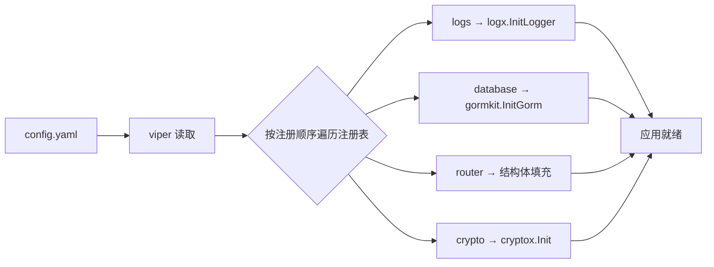

# 05 配置与日志

`configx` 是这个库的入口点：一句 `Setup` 把散落在各包的初始化串起来。理解它的注册表机制，就能解释「为什么我什么都没配，数据库就连上了」，也能避免「为什么启动就报缺配置段」。

## 装配流程



每个注册项包含三样东西：配置段名、目标结构体指针、初始化函数。

```go
func Register(name string, cfg any, fn setupFunc)

func Setup(filename string) error   // 读文件 → 遍历注册表 → 每项都在同一个事务之外独立执行
```

`Setup` 是**串行**的：某一项失败立即返回，之前已经执行的项保持生效（不会回滚）。因此启动失败的日志里最后一行 `Succeed to init X` 通常就是出错点的前一项。

## 内置配置段

| 段名 | 注册者 | 结构体 | 初始化函数 | 字段 |
| --- | --- | --- | --- | --- |
| `logs` | `configx` 自身 | `logx.Config` | `logx.InitLogger` | `logLevel` |
| `database` | `storex/gormkit` | `gormkit.Config` | `gormkit.InitGorm` | `address` `port` `username` `password` `database` `logLevel` |
| `router` | `routerx` | `routerx.Config` | 无（仅填充） | `host` `port` `disableTLS` `certPath` `keyPath` |
| `crypto` | `storex/account` | `cryptox.Config` | `cryptox.Init` | `aesKey` |

规则很简单：**import 即注册**。所以：

- 只 import `logx` → 只有 `logs` 段，配置里多写也没人读；
- import `storex`（内部依赖 `gormkit`）→ 必须有 `database` 段，否则 `InitGorm` 拿着空地址去连接，报 `failed to setup database`；
- 只单独用 `cryptox` 而不 import `account` → `crypto` 段**不会**被注册，需要自己加一行（见 [09 加解密](09-crypto.md)）。

### 两个容易被忽略的细节

1. **`routerx.RouterConfig.OptDefalt()` 不会自动调用。** `router` 段只负责填充结构体，默认值需要应用自己补：

   ```go
   if err := configx.Setup("config.yaml"); err != nil {
       panic(err)
   }
   routerx.RouterConfig.OptDefalt()   // host 默认 0.0.0.0，port 默认 8080
   ```

2. **缺段时走 logger 打一条 warn。** `empty config found for <name>` 由 `logx.Logger` 输出（有统一格式，级别 warn），不影响运行——不需要该段就去掉对应 import。

## 自定义配置段

给业务模块加一个段，三行注册：

```go
var SampleConfig Sample

type Sample struct {
	Port  int
	Host  string
	Debug bool
}

func init() {
	configx.Register("sample", &SampleConfig, func() error { return nil })
}
```

配置里出现 `sample:` 就会被填充：

```yaml
sample:
  port: 8080
  host: localhost
  debug: true
```

初始化函数里有活要干时（连第三方客户端、校验必填项），不要写 `DefaultSetupFunc`：

```go
configx.Register("mq", &MQConfig, func() error {
	if MQConfig.Addr == "" {
		return eris.New("mq.addr is required")
	}
	return mq.Connect(MQConfig.Addr)
})
```

失败会让整个 `Setup` 中断——这正是想要的效果：配置不全就不要启动。

### 按文件注册

有些配置不适合塞进主 YAML（大块 JSON、证书内容）。`RegisterByFile` 的语义是：配置段里只写路径，内容放单独文件。

```go
configx.RegisterByFile("certs", &CertsConfig, loadCerts)
```

```yaml
certs: ./conf/certs.yaml
```

### 调试注册结果

```go
configx.Register("sample", &SampleConfig, configx.DebugSetupFunc("sample", &SampleConfig))
```

初始化时把结构体 JSON 打一行 info，装配顺序不对时很好用。

## 日志

`logx` 暴露一个包级 `Logger`（`*logrus.Logger`），全库共用：

- 输出到 **stdout**，带 caller（`SetReportCaller(true)`），formatter 是自定义的 `MyFormatter`；
- 初始级别是 `trace`，`Setup` 时按 `logs.logLevel` 覆盖；不写该字段则回落到 `info`；
- 命令行工具可以用 `logx.SetLoggerLevel("debug")` 直接改，不需要配置文件。

```go
logx.Logger.Infof("Succeed to init %s", item.name)
logx.Logger.WithField("id", id).Error("...")
```

级别取值：`trace` `debug` `info` `warn` `warning` `error` `fatal` `panic`（logrus 的解析规则）。非法值不会 panic，`SetLoggerLevel` 返回错误并保持默认级别——CLI 里通常用 `cobra.CheckErr` 吞掉。

请求日志不在 `logx` 里，而是 `routerx` 的 gin 中间件：**只打印非 GET/OPTIONS 的请求**，并跳过 `/health`。细节见 [07 HTTP 层](07-http.md)。

## 什么时候不该用 configx

- 单元测试：直接构造结构体调用被测函数，不要 `Setup`——它会尝试连数据库；
- 只需要单个能力的场景（例如 CLI 只重排 import）：不要 import `storex`，避免被迫提供 `database` 段；
- 多份配置需要同时存在（多租户）：`Setup` 是全局单例语义，不支持并存。
