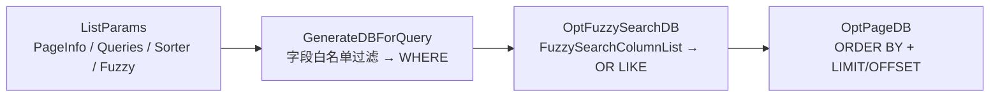

# 06 数据访问

`storex` 把数据访问收敛成一个接口 `database.Database`，`storex/gormkit` 是它的 GORM 实现。换 ORM 时只需要实现这个接口并 `storex.SetDB(d)`，上层代码不用动。

## Model 约定

所有可持久化模型嵌 `storex.Model`：

```go
type Model struct {
	ID        int64 `gorm:"primarykey"`      // 业务生成，非自增
	CreatedAt time.Time
	UpdatedAt time.Time
	DeletedAt gorm.DeletedAt `gorm:"index"`  // 软删除
	Comment   string         `gorm:"size:512"`
	Status    int
}
```

配套三件事：

```go
type Project struct {
	storex.Model `json:",inline"`

	Name  string
	Owner string
}

func (p *Project) TableName() string { return "projects" }

func init() {
	storex.RegisterTable(&Project{})   // 启动时 InitGorm 统一 AutoMigrate
}
```

- **ID 由 `storex.GenerateModel()` 生成**（sonyflake，`int64`），不要依赖数据库自增。
- **`RegisterTable` 必须在 `init()` 里**，且定义模型的包必须被 import，否则表不会被创建。
- **表名一律显式 `TableName()`**，不依赖 GORM 的复数推断。

> sonyflake 的 machine ID 在 `utilsx` 里固定为 `128`。单机多进程没问题；**多台机器同时写同一张表时 ID 段会重叠**，真要多写就要给每台机器分配不同的 machine ID（改 `utilsx/uuid.go`）。

## Database 接口

接口按用途分成五组，完整定义见 `storex/database/database.go`：

| 组 | 方法 |
| --- | --- |
| 上下文 | `Context(ctx)`：返回绑定了新 ctx 的副本 |
| 单对象读 | `Get`、`GetByName`、`GetByField`、`GetByMultiFields` |
| 单对象读（含关联） | `GetAssociations`、`GetAssociationsByName`、`GetAssociationsByField`、`GetAssociationsByMultiFields` |
| 列表 | `List`、`ListWithCount`、`GetCount`、`ListAssociations`、`ListAssociationsWithCount` |
| 写 | `Create`、`Update`、`Delete`、`DeleteAssociations`、`DoDBTransaction` |
| 断言与工具 | `EnsureExist`、`EnsureNotExistByName`、`EnsureNotExistByField`、`GetDBFields` |

获取实例：

```go
db := storex.DB(ctx)        // database.Database，带 ctx
g := storex.GormDB(ctx)     // *gorm.DB，需要 raw SQL 时的逃生舱
```

`storex.DB(ctx)` 每次返回绑定当前请求 ctx 的句柄，因此请求取消会传导到 SQL 层——**不要把它存成全局变量**。

## 写操作

```go
obj := &Project{
	Model: storex.GenerateModel(),
	Name:  "gotools",
}

ei := storex.DB(ctx).DoDBTransaction(func(db database.Database) errorx.ErrorInfo {
	if ei := db.EnsureNotExistByField(obj, "name", obj.Name); ei != nil {
		return ei            // 409 already exists
	}
	if err := db.Create(obj); err != nil {
		return storex.NewErrorInfoForCreateError(err)
	}
	return nil
})
```

`DoDBTransaction` 接收任意多个函数，**任一返回非 nil 即回滚**，全部通过才 commit。事务里必须用回调参数 `db`，用外层的 `storex.DB(ctx)` 会脱离事务。

已有 `*gorm.DB` 时用 `storex.DoGormDBTransaction(g, fn)`，语义相同。

`Update` 是 `Save` 全量保存（`Omit(clause.Associations)`），要做字段级 diff 就在上层用指针参数 + `utilsx.OptStringPtr` 之类合并；`Delete` 走 GORM 软删除，`DeleteAssociations` 会连带清理关联。

### 错误映射

不要把 GORM 错误直接吐给前端，统一走这组映射：

| 函数 | 典型映射 |
| --- | --- |
| `NewErrorInfoForGetError` | `ErrRecordNotFound` → 404，其余 500 |
| `NewErrorInfoForListError` | 400 |
| `NewErrorInfoForCreateError` / `UpdateError` / `DeleteError` | 唯一键冲突 → 400（`already exists` 走 `Ensure*` 是 409），其余 500 |
| `IsNotFoundError` | 布尔判断，用于「不存在也算成功」的场景 |

## 列表查询管线

`typesx.GetListParams(ctx)` 解析 query string，`Database.List*` 再把它翻译成 SQL。三步：



### 查询参数

| 参数 | 含义 | 默认 |
| --- | --- | --- |
| `pageNum` | 页码，非法整数返回 400 | 1 |
| `pageSize` | 每页条数 | 10 |
| `sortBy` | `字段,方向`，多字段用 `:::` 分隔 | `updated_at,desc` |
| `fuzzySearch` | 模糊搜索值，配合 `ListParams.FuzzySearchColumnList` | 空 |
| 其它任意 key | 按「模型字段的 snake_case 名」精确匹配（`col = ?`） | — |

响应固定形状：

```json
{ "pageNum": 2, "pageSize": 10, "pageCount": 3, "count": 25, "items": [] }
```

`pageCount = ceil(count / pageSize)`。

### 过滤与排序的边界

- **未知 query key 会被静默丢弃**：`GenerateDBForQuery` 先用反射取模型字段的 snake_case 集合，只保留命中项。所以传 `foo=bar` 不会报错，也不会影响 SQL。
- **值是字符串**：`col = ?` 直接传 `string`，数字型字段依赖 MySQL 隐式转换；需要严格类型时自己转换后再查。
- **`sortBy` 只接受普通标识符**（`^[A-Za-z_][A-Za-z0-9_]*$`），夹带 SQL 片段会被丢弃；全部非法时回退 `updated_at,desc`，`ORDER BY` 不会为空。
- **字段归属需要自己校验**：上面的规则只防注入，不保证字段真实存在于模型上。要严格就调：

```go
listParam, ei := typesx.GetListParams(ctx)
if ei != nil { /* 400 */ }

if ei := listParam.Validate(new(Project)); ei != nil {
	ctx.JSON(ei.StatusCode(), ei.ErrorMessage())
	return
}
```

`Validate` 允许 `id` / `created_at` / `updated_at` 三个基础字段，其余必须是模型字段。

### 模糊搜索要自己开

`FuzzySearchColumnList` 不是从 query 推出来的，必须由调用方指定：

```go
listParam, _ := typesx.GetListParams(ctx)
listParam.FuzzySearchColumnList = []string{"name", "owner"}   // 这两列 OR LIKE %value%

listObj := make([]Project, 0)
count, err := storex.DB(ctx).ListWithCount(listParam, &Project{}, listObj)
```

`apix` 的默认 `ListHandler` 不设置该字段，所以默认 handler 里 `fuzzySearch` 是无效的；需要模糊搜索时改用自己的 `queryFn`：

```go
apix.ListHandler[account.Account](
	ctx,
	func(db database.Database, p *typesx.ListParams) ([]account.Account, int, errorx.ErrorInfo) {
		p.FuzzySearchColumnList = []string{"username", "name"}
		return apix.DefaultListObjWithCount[account.Account](db, p)
	},
	apix.DefaultTransListObjToResp[account.Account, account.Account],
)
```

> `DefaultListObjWithCount` 的第三个泛型参数在 `database.Database` 里是 `any`，这条改法编译通过、行为与默认路径一致。

### 关联查询

列表要带关联对象时用 `ListAssociations*`，`items` 是关联字段名：

```go
db.ListAssociationsWithCount(listParam, &Order{}, &orders, "Items", "Customer")
```

单对象同理：`db.GetAssociations(obj, id, "Items")`。

## 文件位置与命名

| 关注点 | 位置 |
| --- | --- |
| 接口定义 | `storex/database/database.go` |
| GORM 实现 | `storex/gormkit/{db,db_list,db_utils,setup,model,tables}.go` |
| 门面再导出 | `storex/db.go`（`Model`、`RegisterTable`、错误映射都从这里转出） |

`storex` 只是门面：`storex.Model` 是 `gormkit.Model` 的类型别名，`storex.RegisterTable` 直接指向 `gormkit.RegisterTable`。所以业务代码 import `storex` 一处就够了，不需要同时引 `gormkit`。
