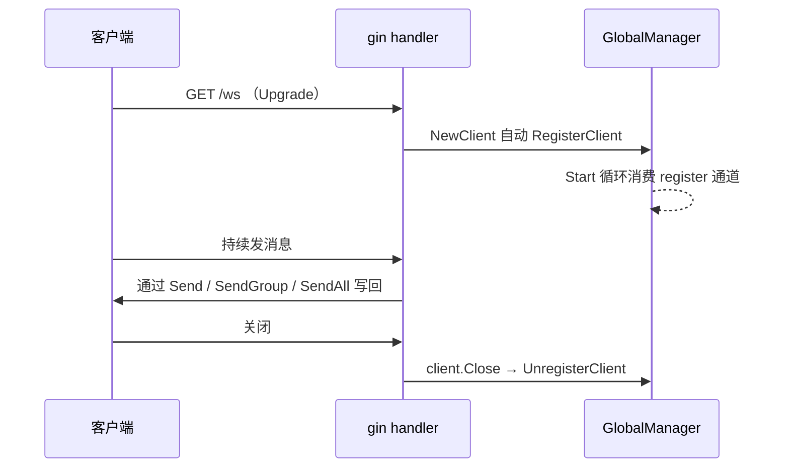

# 10 WebSocket

`websocket` 是一个 Hub 模式的最小实现：所有连接注册到一个全局管理器，按「组」组织，支持单播、组播、广播。它不做鉴权、不做心跳，只解决「连接怎么存、消息怎么发」。

## 生命周期



**`GlobalManager.Start()` 必须在起服务前跑起来**，否则注册与发送都会积压在 channel 里（容量 128），最终阻塞：

```go
go websocket.GlobalManager.Start()
```

## 接入

```go
func wsHandler(ctx *gin.Context) {
	conn, err := websocket.NewConnFromGin(ctx)
	if err != nil {
		logx.Logger.Errorf("upgrade failed: %v", err)
		return
	}

	c := websocket.NewClient("room-1", conn, &websocket.GlobalManager)

	// Read 阻塞到连接关闭，回调里处理客户端消息
	c.Read(func(p []byte) {
		logx.Logger.Infof("recv: %s", p)
	})
}
```

把它挂进路由组即可：

```go
routerx.NewGroup("/ws").AddAPI(
	&routerx.API{Method: "GET", Path: "", Handler: wsHandler},
)
```

`NewClient` 的第三个参数是可变 `Manager`，传 `&websocket.GlobalManager` 就会自动注册；想接自己的管理器（多实例、分片）就实现：

```go
type Manager interface {
	RegisterClient(client *client)
	UnregisterClient(client *client)
}
```

## 发送

```go
websocket.GlobalManager.Send("client-id", "room-1", []byte(`{"msg":"direct"}`))
websocket.GlobalManager.SendGroup("room-1", []byte(`{"msg":"hello"}`))
websocket.GlobalManager.SendAll([]byte(`{"msg":"broadcast"}`))
```

三者的区别只是目标集合：指定 id、指定组、全部。内部都是**异步**的：把消息投进 channel，由 `Start` 的循环逐个 goroutine 写 socket，因此调用方不会被慢连接拖住。

消息体就是原始字节，没有信封格式；`Message` / `GroupMessage` / `BroadCastMessage` 三个结构只用于内部传递路由信息。

## 观测

```go
websocket.GlobalManager.Info()
// map[groupLen:3 clientLen:17 chanRegisterLen:0 chanUnregisterLen:0
//     chanMessageLen:2 chanGroupMessageLen:0 chanBroadCastMessageLen:0]
```

通道长度长期不为 0 说明消费不过来，通常是 `Start` 没跑或写 socket 阻塞。

## 已知限制

- **Origin 默认只放行同源**：`NewConnFromGin` 校验 `Origin` 与请求 `Host` 一致（无 Origin 头的非浏览器客户端直接放行）；跨站接入用 `websocket.SetCheckOrigin(fn)` 覆盖，`fn` 收到 `*http.Request`，可以在里面读 `Authorization` 或 `?token=` 做鉴权，`websocket.AllowAllOrigins()` 关闭校验（公网勿用）。
- **无心跳**：客户端没有 ping/pong，死连接要等下一次读失败才会被清理；长时间空闲的场景需要自己定时发 ping。
- **`Close` 之后再发消息会 panic**：注销时 `client.Message` 会被关闭，而 `consumeMessage` 系列没有 recover。业务侧应先从组里移除再停发。
- **单进程**：连接表在内存里，多副本部署时组播只在本进程生效；跨实例广播需要 Redis pub/sub 之类的外部总线。

适用场景是「单机、连接数不大、消息模型简单」的内部服务；要更完整的语义（房间权限、背压、集群）建议直接上成熟库。
